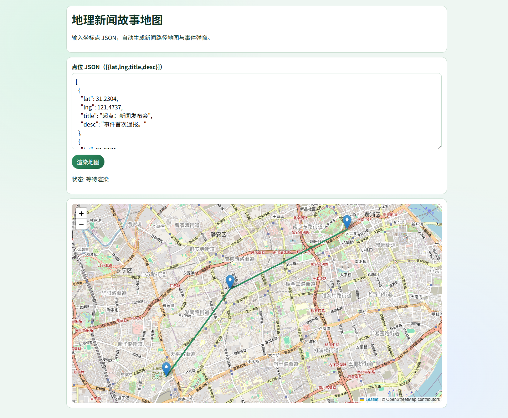

# P15 地理新闻故事地图

## 用途

将新闻事件点位以地图和路径形式可视化展示，支持弹窗叙事。

## 使用

编辑 JSON 点位数组并点击“渲染地图”。


## 隐私说明

- 所有数据处理均在浏览器本地完成，不上传任何数据至服务器。
- 如涉及 API 调用，密钥仅保留在当前页面内存中，不做持久化存储。
- 详见页面底部隐私提示。

## 已知限制

- 仅支持现代 Chromium 内核浏览器 (Chrome 110+, Edge 110+)。
- 地图瓦片加载依赖网络。
- 本工具为前端纯静态实现，不含后端服务。
## 产品化优化（PM）

### 优化目标
- 提升导入-处理-导出的闭环成功率与速度。

### 目标用户
- 一线用户：希望在 3 分钟内完成核心任务的内容/数据/核查从业者。
- 管理者：关注输出质量稳定性、效率提升和可复用流程。

### 核心使用场景
- 导入原始数据后秒级可视化
- 快速清洗并导出可用数据
- 面向非技术用户自助分析

### 北极星指标（上线后 2 周）
- 首次任务完成率 >= 70%
- 核心任务完成时长 P50 <= 3 分钟
- 7 日回访率 >= 20%

### 下一步迭代（按优先级）
1. 增加异常数据提示与修复建议
2. 支持批量操作与预设流程
3. 完善导出格式和质量校验

## 数据化追踪（PM）

### 已接入埋点事件
- `page_view`：页面访问
- `first_interaction`：首次交互时延
- `cta_click`：核心按钮点击
- `task_start` / `task_complete` / `task_error`：核心任务生命周期
- `status_success_signal` / `status_error_signal`：状态文本成功/失败信号
- `page_hidden` / `page_unload`：页面停留与离开

### 看板字段（统一）
- `project_id`（例如：P15-story-map）
- `project_cluster`
- `session_id`
- `event_name`
- `event_time`
- `page_path`
- `control_id`
- `task_name`（当前项目默认：data_pipeline_core_task）
- `task_duration_ms`
- `elapsed_ms`
- `status_text`

### 本地查看与导出
在浏览器控制台执行：

```js
window.pmMetrics.getSummary()
window.pmMetrics.exportEvents()
```

### 上线后两周目标
- 首次交互时延 P50 <= 10 秒
- 核心任务完成率 >= 70%
- 核心任务完成时长 P50 <= 180 秒

<!-- PLAYWRIGHT_REVIEW:START -->
## 页面效果截图（Playwright）

> Captured: 2026-03-02T09:19:19.915Z | Mode: headed (non-headless)



## 可改进点（自动巡检）
- 减少失败请求，建议给第三方资源增加回退策略或本地替代。

- 巡检信号：console_error=0，request_failed=15，load_ms=6096
- 页面标题：P15 地理新闻故事地图

<!-- PLAYWRIGHT_REVIEW:END -->

